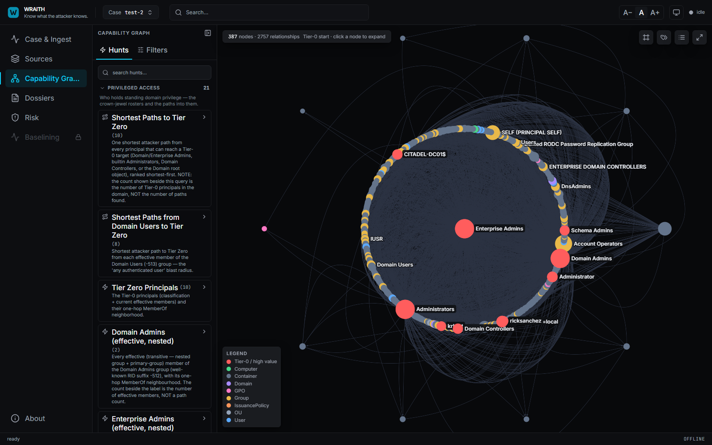
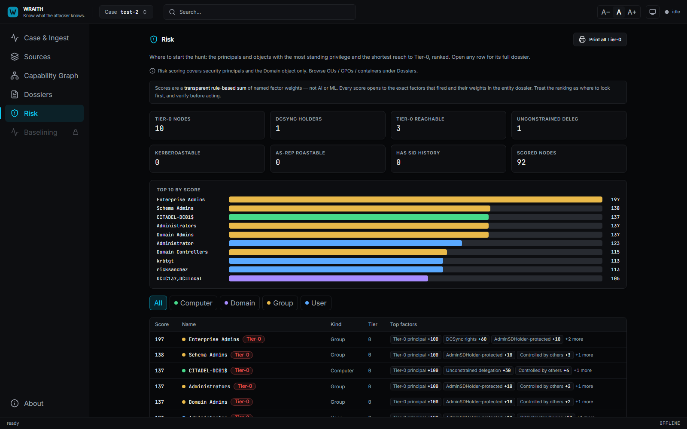
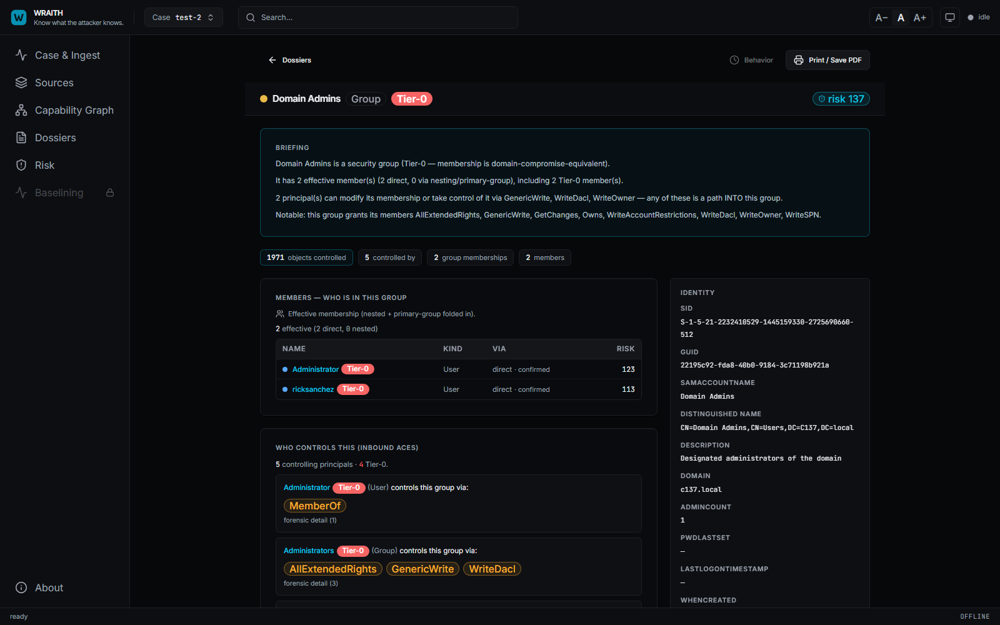
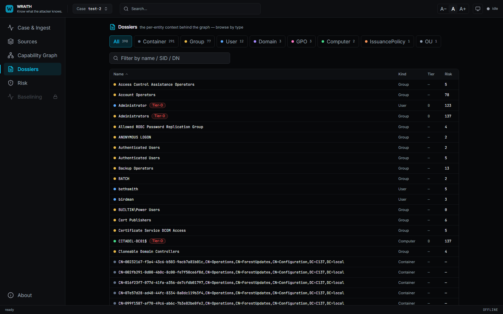

<div align="center">


### Know what the attacker knows.

Offline, dead-disk **Active Directory relationship mapper** for authorized penetration testing and incident response.

[Engineering deep-dive](https://n1ghtfury74.github.io/blog/2026/11/05/building-wraith/) · Offline · Provenance-first · Deterministic

<br/>



<sub>The capability graph with the threat-hunting catalog — reconstructed entirely offline from a dead-disk `ntds.dit`.</sub>

</div>

---

## What it is

Hand WRAITH a single required artifact — the domain controller's **`ntds.dit`** database — and it reconstructs the domain's **privilege and attack graph entirely offline**, with **zero packets to any target**: identities, groups, the full ACL mesh, delegation, domain/forest trusts, and AD CS topology. Everything else is **additive, never mandatory** — feed it more of the disk image and the graph deepens; whatever you don't provide is surfaced as a **counted coverage gap**, never a silent blank:

| Add this artifact | and WRAITH also maps |
|---|---|
| DC **`SYSTEM`** hive | decrypted credential material (hashes/keys as encrypted references) + ESC9 / ESC10 decidability |
| **`SYSVOL`** copy | GPO-pushed local-admin & user-rights edges (`AdminTo` and friends, `Registry.pol`) |
| Member-host **`SAM`** (+ optional `SYSTEM`) | non-GPO local privilege per machine — `AdminTo`, `CanRDP`, `ExecuteDCOM`, `CanPSRemote` |
| Enterprise-**CA host** `SYSTEM`/`SOFTWARE` | `ManageCA` / `ManageCertificates` + full ESC path resolution that needs CA config |
| Other DCs' **`ntds.dit`** | cross-domain / multi-forest merge with an honest divergence ledger |

From whatever you give it, WRAITH answers the questions that shape a hunt or an IR engagement: *who can reach Tier-0, what a given principal controls, and where the attack paths run* — before you touch the live estate.

BloodHound and SharpHound collect from a **live, reachable directory**. WRAITH closes the other case — the one you can't or mustn't touch: a **dead disk image**, an air-gapped lab, or **seized evidence** where live collection is impossible, unsafe, or legally off-limits. It reuses the *ideas* of the attacker-lens graph and the *mature libraries* for the correctness-critical parsing — then builds the same model natively for the offline case, attaching forensic provenance to every node and edge as it goes.

> **BloodHound is one swappable export adapter. The canonical graph is the product.**

## What it produces

- A **capability graph** — identities, groups, ACLs, GPO application, AD CS topology, and host-level privilege, as "who can do what to whom."
- A **threat-hunting catalog** — 56 frozen, one-click hunts across 8 categories, each with a plain-English explanation and live counts (see below).
- **Per-entity dossiers** — the full inbound/outbound control picture for any principal, with paths to Tier-0, rendered in the web UI or exported to **PDF**.
- **Risk findings** — Tier-0 reachability, dangerous ACLs, delegation, AD CS escalation (ESC) exposure.
- **Forensic provenance on every entity and edge** — `{source file, image SHA-256, source object id, directory timestamp}`, attached at creation.
- A **BloodHound CE export** for analysts who want the reference graph UI.

## What it maps

| Area | Edges / facts |
|---|---|
| **Core directory** | `MemberOf`, all ACL edges (`GenericAll`/`WriteDacl`/`WriteOwner`/`AllExtendedRights`/…), `Contains`, `GPLink`, `DCSync`, delegation (unconstrained / constrained / RBCD), `ReadGMSAPassword`, `ReadLAPSPassword`, `HasSIDHistory`, domain/forest **trusts**, node flags |
| **GPO / SYSVOL** | GPO-pushed local-group membership (`AdminTo` and friends), user-rights assignments, `Registry.pol` |
| **Host SAM** | Non-GPO local privilege per machine — `AdminTo`, `CanRDP`, `ExecuteDCOM`, `CanPSRemote` — read from each member host's SAM |
| **AD CS** | Certificate-template topology, enrollment rights, **ESC1–ESC16** where decidable; from the CA host registry: `ManageCA` / `ManageCertificates`, EDITF/InterfaceFlags (ESC6/11/16), and machine-wide DCOM posture |
| **Multi-source** | Multiple DCs / domains / forests with **per-source views first**, an **opt-in merge** that produces an honest **divergence ledger** (deleted-on-one-DC, lingering objects, un-replicated secrets), and cross-domain trust / FSP / SID-history edges |

## Threat hunting

WRAITH ships a **frozen catalog of 56 prebuilt hunts across 8 categories**, nested under the Capability Graph in the UI. Each hunt is pure data (a stable id + plain-English description), runs as a single click, and shows a **live count** next to its label so you can triage before you open it. Counts come from the *exact same* resolvers that feed the Risk dashboard, so the hunt list and the risk model can never disagree.

**Honest by construction:** every hunt carries a confidence badge. Hunts that need evidence WRAITH doesn't collect in v1 are **listed and greyed, never hidden** — so a quiet result means "checked," not "missing."

| Category | Hunts | Runnable now | What it surfaces |
|---|---:|---:|---|
| **Privileged Access** | 21 | 20 | Effective (transitive, nested + primary-group) membership of every well-known privileged group — Domain/Enterprise/Schema Admins, Builtin Administrators, Account/Server/Backup/Print Operators, Key Admins, Protected Users, … — plus paths to Tier-0 and the full privileged set |
| **Credential Exposure** | 10 | 10 | DCSync rights, Kerberoastable & AS-REP-roastable accounts, reversible-password storage, `PASSWD_NOTREQD`, never-expires, SID history, `adminCount` residue |
| **Dangerous ACLs** | 6 | 6 | Controllers of the domain / of Tier-0, ForceChangePassword, WriteSPN, Shadow-Credentials, AddMember-to-privileged-group |
| **Delegation** | 5 | 5 | Unconstrained & constrained delegation, RBCD configured, who can *configure* RBCD on a target, paths to unconstrained-delegation hosts |
| **Topology** | 5 | 2 | Domain/forest trusts and admins-on-a-DC run today; Foreign Security Principals, trust-abuse paths and Azure/Entra paths are greyed (out of v1 scope) |
| **Stale / Risk** | 4 | 2 | Disabled-but-privileged accounts and `adminCount` orphans run; old-password and unsupported-OS need data not collected in v1 |
| **ADCS** | 3 | 3 ⚠️ | Certificate enrollment rights, AD CS PKI topology, shortest paths to ESC abuse — *synthetic-only*: pipeline-wired and tested on synthetic input, **not yet validated on a real AD CS–bearing `ntds.dit`** |
| **Shadow Admins** | 2 | 2 | Tier-0 shadow admins (non-obvious control of Tier-0) and principals that control many objects |
| **Total** | **56** | **50** | |

- **50 hunts run today** on real artifacts; **6** are listed-but-greyed because they need data WRAITH doesn't collect in v1 (analyst "owned" set, FSP reader, OS field, dedicated trust-abuse edges, Azure/Entra).
- **3** (the ADCS category) are badged `data_confidence = "synthetic-only"` — wired and tested against synthetic input, pending a real AD CS artifact + Certipy parity gate.

## The operator console

> A local-first, dark-by-default operator UI. Everything below runs offline against a dead-disk `ntds.dit` — the images use a synthetic lab domain (`c137.local`), never real evidence.

<table>
  <tr>
    <td width="50%" valign="top">
      <br/>
      <sub><b>Risk</b> — where to start the hunt: Tier-0 reachability, DCSync holders, delegation, and a transparent rule-based score (named factor weights, not ML) you can trace to the exact ACEs.</sub>
    </td>
    <td width="50%" valign="top">
      <br/>
      <sub><b>Dossier</b> — the full inbound/outbound control picture for any principal: effective members, who controls it (and via which rights), full identity + provenance, one-click <b>Print / Save PDF</b>.</sub>
    </td>
  </tr>
  <tr>
    <td width="50%" valign="top">
      <br/>
      <sub><b>Browse by type</b> — every object as a dossier (users, groups, computers, GPOs, OUs, containers), filterable by name / SID / DN, ranked by risk.</sub>
    </td>
    <td width="50%" valign="top">
      <br/>
      <sub><b>Capability graph</b> — the attacker-lens graph (387 nodes · 2,757 relationships here) with the 56-hunt catalog docked alongside; click any node to walk its control.</sub>
    </td>
  </tr>
</table>

## The guarantees (non-negotiable)

- **Offline.** No component initiates network egress at runtime. Zero packets to any target.
- **Provenance everywhere.** No fact without its source. Every entity and edge is traceable to the artifact it came from.
- **Secrets, handled.** Credential material is encrypted at rest in the case workspace, redacted by default, and **never logged in plaintext**.
- **Deterministic.** Identical inputs produce identical outputs.
- **Honest coverage.** Missing evidence is a **counted, surfaced gap** — never a silent wrong answer. The UI tells you exactly what each artifact unlocks and what its absence costs.
- **Authorized use only.** WRAITH operates solely on artifacts the operator is lawfully authorized to possess.

## Quick start (Docker)

```bash
docker compose up --build
# WRAITH is now at http://localhost:8000
```

Open the web UI, create a case, drop in a capture folder (or upload `ntds.dit` + the `SYSTEM` hive and any optional artifacts), run the analysis, and explore the graph, dossiers, hunts, and risk. Everything runs offline.

To also bring up the optional Neo4j + BloodHound CE reference stack:

```bash
docker compose --profile bloodhound up --build
```

## Architecture

- **Engine** (`wraith/`) — acquisition · ESE/NTDS parsing · security-descriptor & secret decryption · normalization · membership closure · the edge engine · GPO/SYSVOL · AD CS · host SAM · multi-source reconciliation · the hunt catalog · BloodHound export · dossier/PDF · provenance.
- **Store** — DuckDB as the canonical, analytics-ready store (Parquet-friendly); a capability graph projected over it with NetworkX for pathfinding.
- **Interfaces** — FastAPI + Uvicorn API (with a live WebSocket progress channel), a React/Vite web UI, and a Typer CLI.
- **Reference UI (optional)** — Neo4j + BloodHound CE via `docker-compose`.

Correctness-critical formats are delegated to battle-tested libraries (ESE/NTDS, security descriptors, PEK/secret decryption, registry hives, X.509) — never hand-rolled, never copied.

## Engineering write-up

A module-by-module deep-dive on how WRAITH was built — the parsing chain, the edge engine, the offline and provenance guarantees, and the testing discipline:

**→ [Building WRAITH](https://n1ghtfury74.github.io/blog/2026/11/05/building-wraith/)**

## Authorized use only

WRAITH is for lawful, authorized security work only — authorized penetration testing, incident response, and research on evidence you are permitted to possess. **No live collection. No password cracking. On-prem AD only.** You are responsible for operating within your authorization and the law.

## License

[Apache-2.0](LICENSE).
